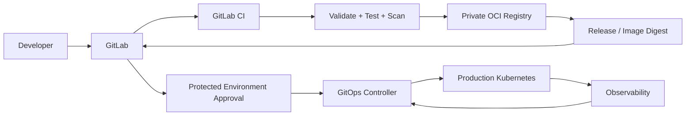

# CI/CD, Production Deployment and Rollback Design

The assignment explicitly allows these capabilities to be designed and documented
without implementing a working GitLab pipeline. This design is specific to this
repository and avoids conflicting ownership between Terraform, Ansible, Kustomize,
and the production deployment controller.

## 1. Proposed production flow



The key rule is that CI builds artifacts; the deployment controller reconciles
production desired state. CI does not run `kubectl apply` continuously against
the same production resources.

## 2. GitLab CI stages

### Stage 1: fast validation

Blocking checks:

- YAML syntax
- Kustomize rendering
- Kubernetes schema validation
- Terraform formatting/validation
- Ansible syntax check
- shellcheck for scripts
- repository secret scan
- dependency lockfile checks

### Stage 2: security

Blocking checks:

- SAST
- dependency/SBOM scan
- container vulnerability scan
- secret detection
- IaC security scan
- image signature/provenance verification

High-severity findings should block production unless an explicitly documented
exception is approved.

### Stage 3: build

Build the application image once.

Use:

```text
registry.example.com/demo-app:<git-sha>
```

and record the resulting immutable OCI digest.

The release artifact contains:

- image digest
- Git commit SHA
- build metadata
- SBOM
- provenance/attestation

The image is never rebuilt for staging or production.

### Stage 4: platform validation

For infrastructure changes:

1. Terraform fmt/validate
2. Terraform plan
3. Ansible lint/syntax check
4. Kustomize render
5. `make test` in an ephemeral/local validation environment when practical

Infrastructure plans are reviewed before apply.

### Stage 5: release

A release is created from a protected branch/tag.

The deployment manifest records the immutable image reference:

```text
registry.example.com/demo-app@sha256:<digest>
```

The source commit, image digest, manifest version and release identifier form one
traceable chain.

### Stage 6: promotion

Promotion changes the desired-state reference from one immutable digest to another.
The exact same image digest is promoted from staging to production.

There is no production rebuild.

### Stage 7: production verification

After reconciliation:

- Deployment becomes Available
- all expected replicas are Ready
- readiness/liveness checks pass
- ingress returns successful HTTP responses
- error rate stays below the deployment threshold
- latency remains inside the SLO
- no abnormal restart spike occurs

If verification fails, promotion stops and the rollback process is evaluated.

## 3. Credential protection

CI credentials are split by responsibility:

| Credential | Used by | Scope |
|---|---|---|
| Registry push | build job | push only |
| Registry pull | cluster | pull only |
| Staging deploy | GitOps/controller | staging only |
| Production deploy | GitOps/controller | production only |
| Terraform | infrastructure pipeline | infrastructure scope only |

Production credentials are protected GitLab variables or preferably short-lived
OIDC-issued credentials. They are unavailable to untrusted merge-request jobs.

No long-lived cluster-admin kubeconfig belongs in the repository.

## 4. Deployment ownership

### Terraform

Terraform owns infrastructure:

- VMs
- networks
- disks
- infrastructure dependencies

Terraform does **not** own application Deployments, Services or Ingress objects.

### Ansible

Ansible owns node operating-system/runtime configuration.

It does **not** continuously reconcile application manifests.

### GitOps controller

The production GitOps controller owns:

- Namespace
- Deployment
- Service
- Ingress
- PDB
- ConfigMaps
- other application-level Kubernetes resources

This creates a single continuous owner for each resource.

## 5. Environment-specific configuration

Use a Kustomize base plus environment overlays:

```text
k8s/app/
  base/
  overlays/
    staging/
    production/
```

The base contains the application shape. The overlay contains environment-specific:

- hostname
- replica count
- resources
- ingress/TLS
- policy
- image digest

Secrets are not committed to the overlays.

## 6. Deployment strategy

For the default HTTP workload:

- RollingUpdate
- `maxUnavailable: 0`
- controlled `maxSurge`
- readiness probe gates traffic
- PDB protects voluntary disruptions

For higher-risk changes, use progressive delivery:

1. deploy small percentage
2. verify error/latency/availability
3. increase traffic
4. complete promotion

A canary controller or service-mesh/proxy-based traffic splitter can be introduced
only if the operational complexity is justified.

## 7. Failed deployment behavior

If the Deployment cannot become healthy:

1. GitOps controller reports degraded status.
2. Promotion is blocked.
3. Automated health checks inspect rollout state and application signals.
4. The last healthy release remains identified by Git history and release metadata.
5. Rollback is performed by reverting the desired-state reference to the previous
   immutable image/configuration.

Do not "fix" a production failure by manually editing live resources and leaving
Git inconsistent.

## 8. Rollback

### Trigger

Rollback can be triggered by:

- failed post-deployment verification
- SLO/error-rate breach
- failed readiness/availability
- severe application regression
- operator decision during an incident

### Source of truth

The previous healthy release is the last GitOps revision whose deployment passed
the production verification gate.

Both the old image digest and old Kubernetes manifests remain available in Git and
the registry.

### Execution

1. Identify previous healthy release.
2. Revert the environment overlay/release reference.
3. GitOps controller reconciles the previous state.
4. Watch Deployment rollout.
5. Verify probes, endpoints, HTTP traffic and key SLO signals.
6. Record the incident and rollback reason.

Rollback requires protected production permissions.

### Rollback failure

If the old release also fails:

- stop repeated automated changes
- keep the service in the safest known state
- engage incident response
- inspect platform dependencies
- restore from a known-good infrastructure/application configuration
- use disaster-recovery procedures when the failure is data-related

## 9. Configuration compatibility

Application and configuration changes should be backward compatible across at least
one deployment step.

For incompatible configuration:

1. introduce the new field/configuration while the old application still works;
2. deploy application support for both forms;
3. migrate the desired state;
4. remove the old form later.

Do not make a rollback depend on a configuration field that the previous binary
cannot understand.

## 10. Database migrations

For a future stateful application, migrations follow an expand/contract model:

1. backward-compatible schema expansion;
2. deploy code that supports old and new schema;
3. backfill;
4. switch reads/writes;
5. contract/remove obsolete schema only after rollback is no longer required.

Database rollback is not assumed to mean reversing a schema migration. Destructive
migrations require a separate recovery/restore strategy.

## 11. Production approvals

Production deployment is a protected environment.

Suggested controls:

- protected main/release branches
- mandatory merge request review
- CODEOWNERS for infrastructure/application manifests
- successful CI checks
- staging verification
- explicit production approval for high-risk changes
- separation between image-build permissions and production-deploy permissions

## 12. Failure handling matrix

| Failure | CI/CD response |
|---|---|
| Test failure | Block merge/release |
| Vulnerability policy failure | Block release or require security exception |
| Image push failure | No release created |
| GitOps reconciliation failure | Promotion stops; investigate |
| Readiness failure | Deployment remains unavailable; evaluate rollback |
| Elevated 5xx/latency | Stop progressive promotion; evaluate rollback |
| Registry unavailable | Existing pods continue if image already cached; new rollout may stall |
| GitOps controller unavailable | Existing workload continues; reconciliation pauses |
