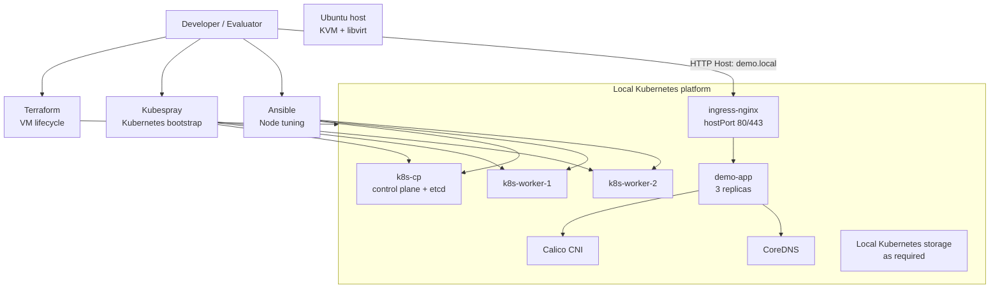

# Platform Design and Implementation

## 1. Scope and status

This document maps the implementation to the assignment requirements.

**Implemented:** Terraform/libvirt VMs, Kubespray Kubernetes bootstrap, containerd,
Calico networking, ingress-nginx, node tuning, application deployment,
probes/resources/security controls, acceptance testing, and a readiness-failure
exercise.

**Designed but not implemented:** GitLab CI/CD, production deployment workflow,
production rollback automation, production observability stack, HPA.

**Out of scope:** production database and a production HA cluster implementation
inside the local lab.

## 2. Architecture



### Traffic flow

```text
Browser/curl
    |
    | HTTP :80, Host: demo.local
    v
libvirt host / VM host ports
    |
    v
ingress-nginx
    |
    v
ClusterIP demo-app:8080
    |
    +--> Pod demo-app-1
    +--> Pod demo-app-2
    +--> Pod demo-app-3
```

The application is reached through ingress rather than NodePort or port-forwarding.

## 3. Resource ownership

The platform intentionally has one owner for each class of resource:

| Resource | Owner |
|---|---|
| VM lifecycle | Terraform/libvirt |
| Kubernetes cluster bootstrap | Kubespray |
| Node OS/runtime tuning | `kernel-tuning` Ansible role |
| Application desired state | Kustomize manifests |
| Ingress controller | Kubernetes/Helm deployment |
| Application runtime objects | Kustomize |
| Production delivery | Designed GitLab CI + GitOps controller |

The node-tuning Ansible role does not attempt to bootstrap or continuously manage
the Kubernetes cluster. Kubespray and the tuning role share the same tuning policy
file where necessary so repeated execution does not oscillate values.

## 4. Reproducibility and idempotency

Terraform creates the three VMs from an Ubuntu cloud image using copy-on-write
disks and cloud-init. The node definitions are data-driven from `variables.tf`.

Kubespray provisions Kubernetes. Ansible is executed serially for node tuning so
a changed node configuration is applied and verified one node at a time.

Kustomize provides deterministic application manifests. Re-applying the same
overlay should converge on the same desired state.

The local cluster intentionally uses one control-plane node. This is a lab
simplification, not a production HA claim.

## 5. Kubernetes and networking choices

- **Virtualization:** libvirt/KVM because it is reproducible on a Linux workstation
  and supports VM lifecycle through Terraform.
- **Bootstrap:** Kubespray because it provides repeatable Kubernetes installation
  while exposing version and cluster configuration.
- **Runtime:** containerd, aligned with modern Kubernetes runtime requirements.
- **CNI:** Calico, providing pod networking and network-policy evolution.
- **Ingress:** ingress-nginx with host ports so the local host can reach HTTP without
  a NodePort or port-forward.
- **Service discovery:** CoreDNS.
- **Application configuration:** Kustomize, avoiding two continuously competing
  deployment managers for the same application resources.

## 6. Application

The application has three replicas, a RollingUpdate strategy with
`maxUnavailable: 0`, resource requests/limits, readiness and liveness probes,
non-root execution, `RuntimeDefault` seccomp, dropped Linux capabilities, and
privilege escalation disabled.

The container image is pinned by digest rather than relying on a mutable-only tag.
The application is named `demo-app-v1.0.0` in the HTTP response so the deployed
release is visible during verification.

A PodDisruptionBudget requires two available replicas during voluntary disruption.

## 7. Node/runtime tuning

### 7.1 Why tune at all

A default Ubuntu node is sized for a general-purpose server. A Kubernetes node
runs many containers, thousands of connections and many file watchers on one
kernel. The stock limits for ARP tables, connection tracking, inotify and open
files are too low for that, and they fail silently: dropped packets, "too many
open files", pods that cannot start. The kubelet also requires specific kernel
values and refuses to start without them. Tuning gives identical, verifiable
node behavior instead of per-node surprises.

All values live in `vars/tuning.yml`. Where a value is a kubelet or kernel
default, it is restated so the intent is explicit and reviewable.

### 7.2 Where each value comes from

| Origin | Examples | Changeable? |
|---|---|---|
| Required by kubelet (`protectKernelDefaults: true`) | `vm.overcommit_memory`, `vm.panic_on_oom`, `kernel.panic`, `kernel.panic_on_oops`, `kernel.keys.root_maxkeys`, `kernel.keys.root_maxbytes` | No. Kubelet will not start if they differ. |
| Kubernetes/kernel defaults, restated | `ip_forward`, bridge-nf-call, `fs.nr_open`, image min GC age, log size, shutdown grace | Rarely. |
| Published formula or vendor requirement | kube-reserved tiers (the schedule GKE publishes), `vm.max_map_count` (Elasticsearch minimum) | Only with a reason. |
| Site-chosen headroom | somaxconn, SYN backlog, conntrack, ARP thresholds, inotify, eviction percentages, `podPidsLimit` | Yes, but measure first (see 7.9). |

### 7.3 Kernel modules

| Module | Why |
|---|---|
| `overlay` | containerd uses overlayfs for image layers. |
| `br_netfilter` | Makes bridged pod traffic visible to iptables. The `net.bridge.*` keys do not exist until it is loaded. |
| `nf_conntrack` | Connection tracking. `nf_conntrack_max` does not exist until it is loaded. |

The role loads them immediately, writes `/etc/modules-load.d/k8s.conf` for boot,
and only then applies sysctl, because setting a key before its module exists fails.

### 7.4 Kernel sysctl values (`/etc/sysctl.d/90-k8s-tuning.conf`)

| Key | Value | Why |
|---|---|---|
| `net.ipv4.ip_forward` | 1 | The node routes packets between pod interfaces and the network. |
| `net.bridge.bridge-nf-call-iptables`, `...-ip6tables` | 1 | Bridged traffic passes through iptables so Service rules and NetworkPolicy apply. |
| `net.ipv4.conf.all.accept_source_route` | 0 | Ignore packets that dictate their own route. Hardening. |
| `net.ipv4.conf.all.accept_redirects` | 0 | Ignore ICMP redirects that could alter routing. Hardening. Set on `all` only; benchmarks usually also set `conf.default.*`. |
| `net.ipv4.tcp_syncookies` | 1 | When the SYN queue overflows, answer with cookies instead of dropping real clients. Protects against SYN floods. |
| `net.core.somaxconn` | 4096 | Ceiling for the `listen()` accept queue. Old kernels defaulted to 128; kernels 5.4+ already default to 4096. The application must also request a large backlog. |
| `net.ipv4.tcp_max_syn_backlog` | 8192 | Queue for half-open connections, set at twice `somaxconn` so it is not the first bottleneck. |
| `net.ipv4.ip_local_port_range` | 32768 65535 | About 32,800 outbound ports instead of 28,200 (default upper bound 60999), useful when many pods are NATed through one IP. The lower bound stays above the NodePort range (30000-32767). |
| `net.ipv4.tcp_keepalive_time` / `intvl` / `probes` | 600 / 30 / 5 | A dead peer is detected after 600 + 30 x 5 = 750 s, instead of about 2 h 11 min with defaults (7200 / 75 / 9). Only affects sockets that enable keepalive. |
| `net.netfilter.nf_conntrack_max` | 131072 | Connection-tracking table size. A full table drops new connections ("table full"). Equals kube-proxy's default minimum. |
| `net.ipv4.neigh.default.gc_thresh1` / `2` / `3` | 4096 / 8192 / 16384 | ARP/neighbor table (defaults 128 / 512 / 1024). Many pod interfaces overflow the default ("neighbour table overflow"). IPv4 only. |
| `fs.file-max` | 2097152 | System-wide open-file cap. Twice `nr_open`. |
| `fs.nr_open` | 1048576 | Per-process ceiling; no `ulimit` or `LimitNOFILE` can exceed it. Kernel default, pinned. |
| `fs.inotify.max_user_instances` | 8192 | Default 128. Counted per user ID; most containers run as root, so they share one budget with kubelet. |
| `fs.inotify.max_user_watches` | 262144 | Default 8192 on older kernels. Watches use non-swappable kernel memory (about 1 KB each on 64-bit, worst case roughly 256 MB). |
| `vm.max_map_count` | 262144 | Default 65530. Elasticsearch/OpenSearch require at least this; JVM and mmap-based software benefit. |
| `vm.overcommit_memory` | 1 | Required by kubelet. Avoids fork and allocation failures; cgroup limits already cap container memory. |
| `vm.panic_on_oom` | 0 | Required by kubelet. An OOM kills a process; it never panics the node. |
| `kernel.panic` | 10 | Required by kubelet. Reboot 10 s after a panic instead of hanging forever. |
| `kernel.panic_on_oops` | 1 | Required by kubelet. A kernel oops becomes a panic and reboot instead of running on a damaged kernel. |
| `kernel.keys.root_maxkeys`, `root_maxbytes` | 1000000, 25000000 | Required by kubelet. Many containers create session keyrings; the stock limits are small. |

### 7.5 Kubelet sizing

Allocatable = capacity - kube-reserved - system-reserved - hard eviction threshold.
Pods can only be scheduled against allocatable.

| Setting | Value | Why |
|---|---|---|
| `tuning_kube_reserved_mem_mi` | tiered formula | 25% of the first 4 GiB, 20% to 8, 10% to 16, 6% to 128, 2% above. Small nodes pay a larger share because kubelet and the runtime cost more per GiB there. Examples: 4 GiB = 1024 Mi, 8 GiB = 1844 Mi, 16 GiB = 2663 Mi, 32 GiB = 3646 Mi. |
| `tuning_kube_reserved_cpu_m` | tiered formula | 60m for the first core, 10m for the second, 5m each for cores 3-4, 2.5m per core above. Examples: 2 cores = 70m, 4 = 80m, 8 = 90m, 16 = 110m. |
| `tuning_system_reserved_mem_mi`, `_cpu_m` | 256 Mi, 100m | For sshd, journald, chrony and other OS daemons. |
| `tuning_evict_hard_mem_mi` | 200 Mi | Hard memory eviction threshold; also subtracted from allocatable. |
| `tuning_avg_pod_mem_mi` | 64 Mi | Assumed average pod footprint used only to compute maxPods. Replace with your real p90 pod request. |
| `kubelet_min_pods`, `kubelet_max_pods_cap` | 20, 110 | maxPods = (memory - kube-reserved - system-reserved - eviction) / 64 Mi, clamped to 20-110. 110 is the Kubernetes default cap and fits a /24 node pod CIDR. A 4 GiB node gets 40, an 8 GiB node 92, 16 GiB and larger 110. |
| `kubelet_pod_pids_limit` | 4096 | Per-pod process/thread cap (upstream default is unlimited), so one pod cannot exhaust node PIDs. Thread-heavy pods such as large JVMs may need more. |

Reservations are not cgroup-enforced (`enforceNodeAllocatable: [pods]`). They only
shrink allocatable, so a reservation set too low can never get kubelet or
containerd killed.

### 7.6 Kubelet behavior

| Setting | Value | Why |
|---|---|---|
| `kubelet_protect_kernel_defaults` | true | Kubelet refuses to start if the six required kernel keys drift. Drift is caught immediately. |
| `kubelet_fail_swap_on` | true | Kubelet refuses to run with swap on. The role disables swap and comments out fstab entries. |
| `cgroupDriver` | systemd | Must match containerd's `SystemdCgroup = true`. Both are verified. |
| `kubelet_shutdown_grace_period` | 60s | Total time pods get to stop when the node shuts down. |
| `kubelet_shutdown_grace_period_critical_pods` | 20s | The last 20 s is reserved for critical pods, so ordinary pods get 40 s. |
| `kubelet_logfiles_max_size`, `_max_nr` | 10Mi, 3 | At most about 30 Mi of logs per container on the node. Kubelet default is 5 files. |
| `kubelet_image_gc_high_threshold` / `low` | 75 / 65 | Image cleanup starts at 75% disk usage and stops at 65% (defaults 85 / 80), so it runs before any eviction. |
| `kubelet_image_minimum_gc_age` | 2m | Freshly pulled images are never removed immediately. |
| `kubelet_image_maximum_gc_age` | 168h | Images unused for 7 days are removed even without disk pressure. Needs kubelet 1.30 or newer, which the role asserts. |
| `kubelet_kernel_memcg_notification` | true | The kernel notifies kubelet the moment a memory threshold is crossed instead of waiting for the next poll. |

### 7.7 Eviction ladder

Actions escalate from gentle to last resort:

| Resource | Image GC | Soft eviction (after grace) | Hard eviction (immediate) |
|---|---|---|---|
| Image filesystem | usage above 75% | available below 20%, grace 2m | available below 15% |
| Node filesystem | n/a | available below 15%, grace 2m | available below 10% |
| Memory | n/a | available below 500Mi, grace 1m30s | available below 200Mi |

Other hard thresholds: `nodefs.inodesFree` below 5%, `imagefs.inodesFree` below
5%, `pid.available` below 10%. Compared with kubelet defaults, memory is raised
from 100 Mi to 200 Mi, and the image-inode and PID thresholds are added.

- Hard eviction kills pods with no grace period. It is the last line of defense.
- Soft eviction only acts if the condition lasts longer than its grace period, and
  `kubelet_eviction_max_pod_grace_period: 30` caps how long pods get to stop.
- Soft thresholds sit above hard ones, so kubelet always starts gently first.

### 7.8 containerd, OS and file-descriptor limits

| Setting | Value | Why |
|---|---|---|
| `containerd_version` | 2.3.7 | The role asserts the installed version matches, so the wrong config template (version 3 for 2.x, version 2 for 1.x) is never applied. Set it to the exact installed version before running. |
| `pause_image` | registry.k8s.io/pause:3.10 | The sandbox image is pinned so nodes do not pull it at runtime and it is not garbage-collected. It must exist in your registry. |
| `containerd_nofile` | 1048576 | `LimitNOFILE` for containerd, equal to `fs.nr_open`. `TasksMax=infinity` is also set because default per-service task limits can be too low for a runtime. |
| `kubelet_nofile` | 1000000 | `LimitNOFILE` for kubelet, below `nr_open` so systemd can always apply it. The exact figure is a rounded choice; nothing in the repo derives it. |
| login limits (`limits.d`) | soft 65536, hard 1048576 | Affects SSH sessions only. Services ignore this file, which is why kubelet and containerd have their own limits. |
| swap | off | Required by `failSwapOn`. |
| chrony `makestep 1.0 3` | | The clock may jump if more than 1 s off during the first three updates (fresh or resumed VMs). Correct time matters for etcd and certificate validation. `chrony_servers` is empty, so distro defaults are used. |
| `journald_max_use`, `_keep_free`, `_retention` | 500M, 1G, 7day | Logs cannot fill the root disk, which would otherwise trigger node-filesystem eviction. Rate limit (30 s, burst 10000) is the systemd default, pinned. |
| `sysctl_config_file` | /etc/sysctl.d/90-k8s-tuning.conf | Where sysctl values persist across reboots. |

### 7.9 Value precedence

Ansible, lowest to highest: role defaults, inventory `group_vars`,
`vars/tuning.yml` (`vars_files`), computed `set_fact` values, then `-e` on the
command line. The role defaults hold no policy: `k8s_sysctl` is empty and the
reserved values are 0, so the role does nothing useful without `vars/tuning.yml`.

On the node: the later file in `/etc/sysctl.d/` wins (Kubespray's default file
sorts after `90-`, hence `additional_sysctl_min` in the Kubespray `group_vars`),
kubelet flags beat its config file, and systemd drop-ins beat the unit file.

### 7.10 Validation and production note

The numbers are headroom choices for this lab. In production they should come
from workload p95/p99 usage, node capacity and measured pressure, then be
validated with load tests before rollout. Useful checks:

- conntrack: `nf_conntrack_count` against `nf_conntrack_max`
- accept queue: `nstat -az TcpExtListenOverflows TcpExtListenDrops`
- ARP table: `ip neigh | wc -l`
- file handles: `/proc/sys/fs/file-nr`

Verification is automated by the role's `verify` tasks: every sysctl value, swap,
clock sync, containerd cgroup setting, the running `LimitNOFILE` of kubelet and
containerd, the live kubelet configuration, and node Ready state. It is included
in `make test`.

### Production note

The numbers are headroom choices for this lab. In production they should come
from workload p95/p99 usage, node capacity and measured eviction and
file-descriptor pressure, and be validated with load tests before rollout.

Verification is automated by the role's `verify` tasks (sysctls, service open-file
limits, live kubelet config, node Ready) and included in `make test`.

## 8. Failure exercise

Run:

```bash
make failure-test
```

The script changes the application readiness probe to an invalid path. Kubernetes
then marks the new pods unready and removes them from Service endpoints. The script
observes that ready capacity drops below three replicas, restores the correct probe,
waits for the rollout to converge, and verifies three ready replicas.

Expected behavior:

1. Probe failures are visible through pod/workload status and events.
2. Unready pods do not receive normal Service traffic.
3. Deployment status reports reduced availability.
4. Restoring the probe causes the Deployment to converge.
5. The final state returns to three ready replicas.

This tests application health handling rather than merely deleting a pod.

## 9. Operational visibility

The local implementation intentionally uses Kubernetes-native visibility:

```bash
kubectl get nodes
kubectl get pods -A
kubectl get deployment -n demo
kubectl get events -A --sort-by=.lastTimestamp
kubectl logs -n demo deploy/demo-app
kubectl describe pod -n demo <pod>
kubectl get endpoints -n demo demo-app
```

The acceptance test consumes these same primitives and verifies the conditions
that matter to the assignment.

## 10. Security

Implemented locally:

- no password-based SSH
- disabled root SSH
- SSH key authentication
- workload runs as non-root
- privilege escalation disabled
- all Linux capabilities dropped
- RuntimeDefault seccomp
- no application Secret is required
- image is digest pinned
- resource limits reduce accidental resource exhaustion
- generated Terraform state and virtual-environment content are excluded from the
  intended submission archive

Production additions:

- GitLab protected environments and protected branches
- short-lived workload/deployment credentials
- external secret manager/Vault
- image vulnerability/signature verification
- admission policy for security context and image provenance
- private registry
- network policies
- centralized audit logging
- encryption at rest and in transit

## 11. Production evolution

### High availability

Replace the single control plane with three control-plane nodes across failure
domains, use a production load balancer for the Kubernetes API, and use redundant
ingress nodes/load balancers.

### Storage

Use a CSI-backed replicated storage platform or managed block/file storage.
Define backup and restore objectives rather than treating persistent volumes as
backups.

### Secrets

Use Vault or the cloud secret manager and deliver short-lived credentials to
workloads. Secrets must not be stored in Git.

### Upgrades

Pin Kubernetes/Kubespray versions, test upgrades in a disposable environment,
perform control-plane and node rolling upgrades, and validate workloads between
stages.

### Backup / disaster recovery

Back up etcd and application data independently. Test restoration and define RPO/RTO.

### Environment isolation

Separate development, staging, and production clusters/accounts/projects, with
separate credentials and deployment approvals.

### Network security

Use private networks, ingress TLS, network policies, restricted egress, and
firewall/security-group controls.

## 12. Assignment mapping

The assignment requires the evaluator to be able to recover the environment from
version control, verify node/runtime tuning, reach the application through
ingress, inspect operational state, perform a failure exercise, and execute one
acceptance command. The repository provides these through Terraform/Kubespray/
Ansible/Kustomize plus `make test`.

The CI/CD, deployment, rollback, and production-observability requirements are
covered separately in `docs/CI-CD.md` and `docs/OPERATIONS.md`.
